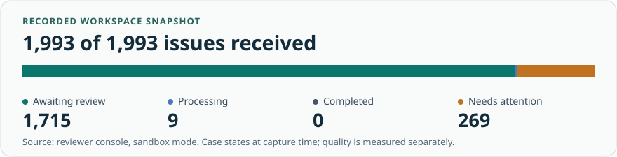
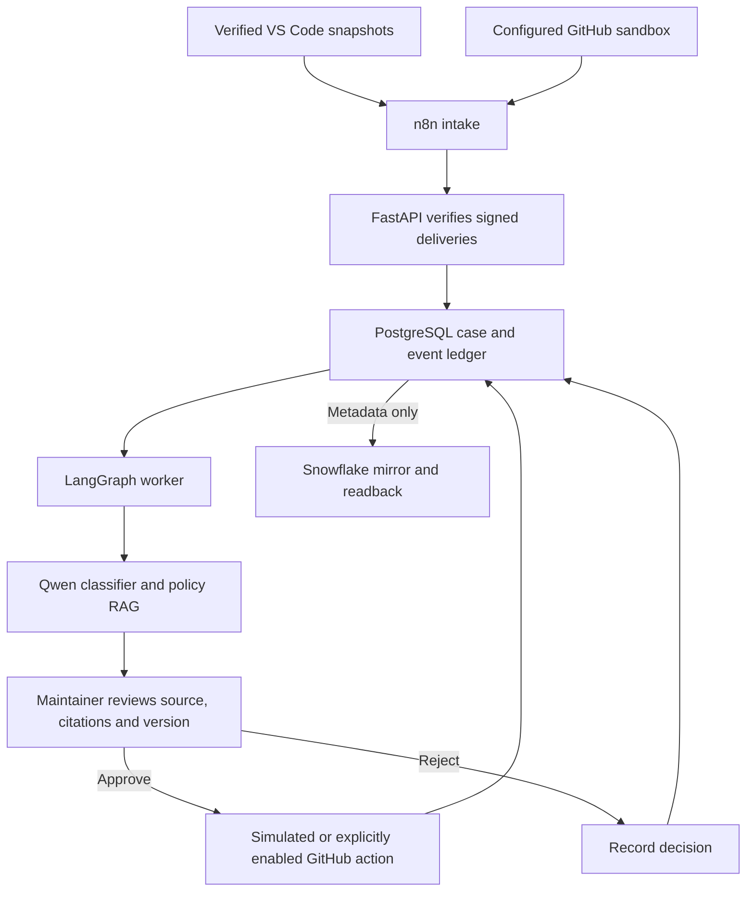

# IssuePilot

**A maintainer workspace for evidence-backed GitHub issue triage.** IssuePilot reads an opening report, proposes a category, retrieves the applicable repository policy and drafts an action. A maintainer sees the source beside the proposal, checks its citations and approves or rejects that exact version. The audit trail records what actually happened.

[Architecture and data model](issuepilot/docs/architecture.md) · [Model evaluation](issuepilot/docs/ai-selection.md) · [Try the benchmark](ai-bench/BENCHMARK.md) · [Demo walkthrough](issuepilot/docs/portfolio-demo.md) · [CI runs](https://github.com/BlazingVermilion/issuepilot-sandbox/actions/workflows/ci.yml)

## What the demo shows



The snapshot workspace received **1,993 distinct historical VS Code issues** without opening or modifying issues on GitHub. For [issue #327459](https://github.com/microsoft/vscode/issues/327459), a maintainer could compare the original report with a proposed `bug` label and open its saved evidence from `IP-INFO-001`. At capture time, 1,715 cases awaited review, 9 were processing, 269 needed attention and **none had completed**. The [walkthrough](issuepilot/docs/portfolio-demo.md) explains what each screen proves.

## How it works



The serving profile uses **Ollama / Qwen3 8B** for both stages. Classification uses only the title and body. RAG ranks 32 policy sections using topic-weighted BM25 and adds required dependencies; the generator must cite supplied section IDs or abstain. LangGraph persists the review and clarification waits. A separate action ledger lets the worker reconcile an uncertain write after a disconnect. [System, graph, RAG, ERD and tools by layer →](issuepilot/docs/architecture.md)

## What was measured

| Question | Recorded result | Population |
|---|---:|---|
| Does the classifier choose the correct category? | **86.50% accuracy**, macro-F1 **0.8691**; rules: **18.00%**, **0.2834** | Same 200 held-out issues; Qwen correct on 173, abstained on 2 |
| Does retrieval find the required policy? | **14/14** complete contexts; Recall@4 **1.000**, Precision@4 **0.3393** | 16 held-out policy scenarios; 14 had relevant evidence |
| Does the selected protocol make the expected action decision? | **26/26**; 4 allow, 18 block, 4 need facts | Development result within 36 validation scenarios, not a held-out generation score |
| Is the answer faithful to the evidence? | **Unmeasured for the final generator** | 92/92 citation IDs valid on validation; no calibrated semantic score |

These measurements support a **human-reviewed candidate**. The classifier remains below the project’s 90% accuracy and macro-F1 0.90 targets; the policy test does not establish held-out end-to-end accuracy. The original issue body can contain reporter hints such as “Type: Bug”; gold labels and prior assistant messages are excluded from inference. See [full results vs targets](issuepilot/docs/ai-selection.md), [machine-readable evidence](ai-bench/evidence/selection.json) and [dataset revision / checksums](ai-bench/fixtures/dataset_source.json).

## Try it without a GPU or accounts

If this is your first checkout, run `git clone https://github.com/BlazingVermilion/issuepilot-sandbox.git` and `cd issuepilot-sandbox`. For an existing clone, run `git pull --ff-only` in that directory instead. From the repository root in Windows PowerShell:

```powershell
cd ai-bench
py -3.12 -m venv .venv
.\.venv\Scripts\python.exe -m pip install -r requirements.txt
.\.venv\Scripts\python.exe bench.py --dataset-config examples/local/profile.json classify --modes rules --split validation --out runs/sample-class
.\.venv\Scripts\python.exe bench.py --dataset-config examples/local/profile.json classify-report --out runs/sample-class
.\.venv\Scripts\python.exe bench.py retrieval --modes policy --split test --device cpu --out runs/policy-test
```

Open `runs/sample-class/comparison.md` for the small classifier example and `runs/policy-test/policy.json` for actual held-out retrieval. Use fresh output directories for fresh runs. On macOS/Linux use `python3.12` and `.venv/bin/python`. The [benchmark guide](ai-bench/BENCHMARK.md) covers real Qwen inference, a different local model or dataset, all 1,993 issues, alternative RAG architectures and optional judging.

## Run on Windows

You need **Python 3.12, Docker Desktop with Compose, Ollama**, and a local n8n editor. Use the copy of this repository that contains `manage.py`; open a new terminal there if you just ran the benchmark in `ai-bench`. No GitHub token or Snowflake account is needed for the demo.

1. **Start the workspace.** Open your existing n8n workflow in its browser tab. If you have never installed n8n, follow the [first-time setup](issuepilot/docs/runbook.md#first-time-n8n). Start Ollama and run:

   ```powershell
   ollama pull qwen3:8b
   py -3.12 .\manage.py start
   ```

   On first start, paste the URL of the **saved workflow editor** when asked. The launcher verifies the pinned source and starts PostgreSQL, the API and worker. It reuses n8n on its existing port.

2. **Connect n8n once.**

   ```powershell
   py -3.12 .\manage.py workflow
   ```

   Click the empty canvas in that workflow, paste the three copied nodes and **publish** (activate on versions using that label). The Production Webhook is `POST /webhook/issuepilot/issues`. Then run:

   ```powershell
   py -3.12 .\manage.py check
   if ($LASTEXITCODE -ne 0) { throw 'Stop: the published intake route did not verify.' }
   py -3.12 .\manage.py submit --resume
   ```

3. **Review one issue.** Run `py -3.12 .\manage.py reviewer`, open [localhost:8021](http://localhost:8021), connect, then choose **Inbox → Review**. Use **View policy evidence** and **Open audit history** to inspect that case. Approvals in this workspace are simulated locally. Use `manage.py status` to distinguish receipts, model proposals and reviews. For real-model diagnostics use `manage.py verify-model`; add `--require-gpu` to require GPU offload.

4. **Stop or resume safely.** `py -3.12 .\manage.py stop` retains the data. Use `start` again and `submit --resume` after an interruption. `py -3.12 .\manage.py settings-path` prints the active settings path without exposing credentials. `demo.py` is a compatibility alias, not another stack.

## Operations and further reading

| To do this | Start here |
|---|---|
| Understand the API, RAG, LangGraph interrupts and PostgreSQL schema | [Architecture](issuepilot/docs/architecture.md) |
| Inspect metrics, limitations and reproduce both AI layers | [Selection report](issuepilot/docs/ai-selection.md) · [benchmark instructions](ai-bench/BENCHMARK.md) |
| Recover an uncertain write, diagnose a webhook, or enable a separate live sandbox | [Operator runbook](issuepilot/docs/runbook.md) |
| Set up service permissions, check the connection and verify the event mirror | [Snowflake walkthrough](issuepilot/docs/snowflake.md) · [read-only reports](issuepilot/warehouse/intake_metrics.sql) |
| Inspect CI, image publishing and opt-in deployment by immutable digest | [GitHub workflows](.github/workflows/) · [Actions history](https://github.com/BlazingVermilion/issuepilot-sandbox/actions) |
