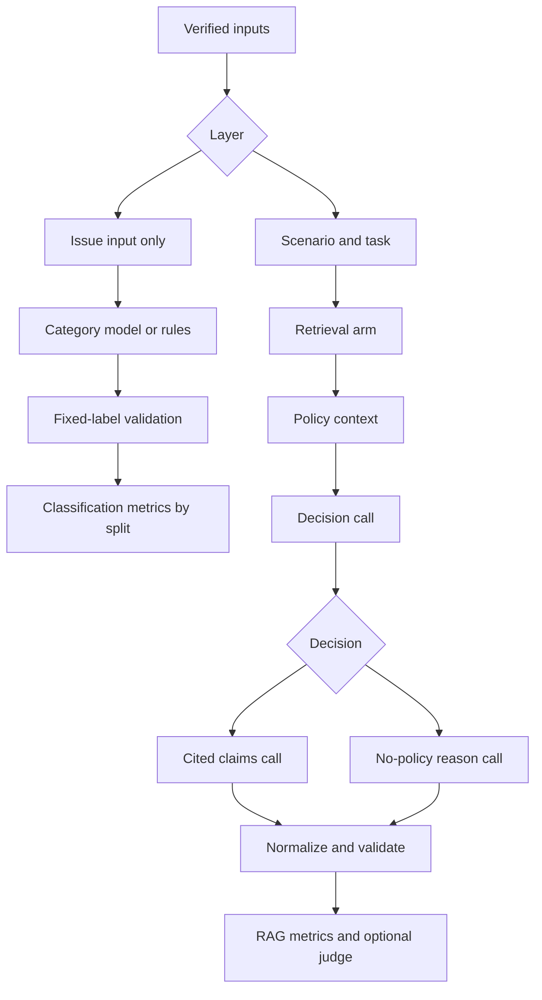
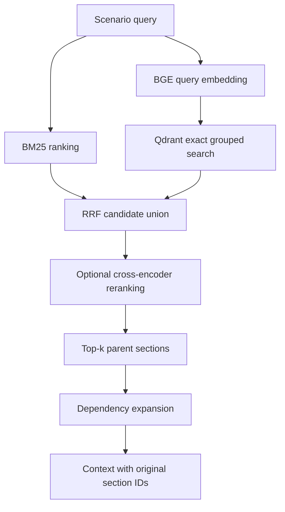

# AI benchmark architecture and contracts

## Experiment boundary

Two independent benchmark layers share a transport, model identity and error vocabulary. The default source has two categories; a custom profile can define a different vocabulary. RAG answers policy questions; it does not perform category classification or execute production actions. All measured labels/references are held outside ordinary inference payloads.

Main generator: `qwen3:8b`, temperature 0, seed 42, `think=false`. Determinism is not promised across hardware or runtime changes. The comparative runner defaults to 128 classification output tokens and 1,536 RAG output tokens; the selected policy arm uses 512 as documented in the benchmark guide. A 2,048-token template reserve is added to published Qwen tokenizer counts. This is a conservative content budget, not an exact reproduction of arbitrary Ollama templates.

## Classification contracts

| Stage / code | Input | Output | Checks and failure behavior |
|---|---|---|---|
| `classification.source` | Pinned dataset repository/revision + SHA256 per split | 1,993 records with split membership | Hashes, exact counts, integer issue IDs, cross-split ID uniqueness, two-label vocabulary, nonempty input |
| Prompt assembly | `row.input` only + selected policy context | System/user strings | `label`, assistant `messages`, gold and split do not enter prompt; the full source row is never serialized |
| Optional retrieval | Issue input + corpus; `none`, `full` or retrieved arm | Section-ID → full text | No oracle in classification; oversized dense/rerank queries stop preflight rather than silently truncate |
| `Ollama.chat` | Prompt + category schema | Parsed JSON + raw response and runtime metadata | Context, HTTP, incomplete response, output truncation and JSON errors remain visible |
| Category validation | `{category: ...}` | `bug`, `feature-request`, `ABSTAIN` | Additional properties/unknown category rejected; error becomes `ERROR`, not `ABSTAIN` |
| Scoring | Saved prediction joined to held-out label by ID | Overall and per-split summary | Errors/abstentions are wrong for accuracy and FN for applicable class; macro-F1 always averages the two classes |

No self-reported confidence score is used as probability or a permission gate. The rules baseline is an explicitly versioned lexical heuristic, not Qwen. No model training occurs here. All-split results are descriptive; a repeatedly inspected test split is not a fresh holdout.

Classification retrieval is prepared before generation and its time saved separately. Reported per-request latency adds that retrieval time to generation time; it excludes index construction, downloads and preflight. RAG times retrieval and generation within each case. Index time is runtime metadata, never part of the reproducibility identity.

## RAG ingestion: one shared corpus

| Stage / code | Input | Output | Invariant |
|---|---|---|---|
| `retrieval.sections` | Versioned `policies/issuepilot_policy.md` | Ordered unique `{id,text}` sections | Stable `IP-*` IDs; empty/duplicate structure rejected |
| BM25 index | Full sections | Term frequencies, document lengths, document frequencies | Lexical normalization is independent of embeddings |
| Dense child chunks | Each section tokenized with BGE tokenizer | Windows of at most 384 tokens, stride 320 + parent mapping | Section endings remain represented; children are not evaluation units |
| BGE encoder | Child strings | Normalized finite nonzero 384-dimensional vectors | Exact revision recorded; shape/parent mapping validated |
| Qdrant index | Vectors + parent section ID/text | Persistent content-addressed cosine collection | Fingerprint includes corpus, encoder revision, children and vector bytes; exact point count checked |
| Local `.npy` cache | Same fingerprint inputs | Reusable embedding matrix | Cache only; all dense similarity queries execute in Qdrant, no silent NumPy search fallback |

Embedding model: `BAAI/bge-small-en-v1.5`. Reranker: `cross-encoder/ms-marco-MiniLM-L6-v2`. Revisions resolve into `models.lock.json` on first use and enter run identity. Qdrant server version/collection fingerprint are recorded. Compose binds Qdrant to localhost.

## Retrieval arms and controls

| Arm | Query → candidate algorithm | Ranked output | Final context |
|---|---|---|---|
| `bm25` | Lexical query terms → BM25 over full sections | Section IDs, descending score, ID tie-break | First k sections + explicit dependency closure |
| `dense` | Query prefix + BGE query vector → exact Qdrant cosine → best child per section | Parent section IDs, descending score | First k sections + dependencies |
| `hybrid` | BM25 and dense section rankings → top 10 each → reciprocal-rank fusion, constant 60 | Candidate union ordered by fused score | First k + dependencies |
| `hybrid-rerank` | Same fusion → up to 20 union candidates → cross-encoder on bounded child passages → best passage per section | Reranked parent IDs | First k + dependencies |
| `full` | No retrieval selection | N/A (not a ranked system) | Every policy section |
| `oracle` | Gold relevant source IDs deliberately supplied to selector | N/A (not a ranked system) | Relevant sections + dependencies; no gold answer in generation |
| `none` | No evidence supplied | N/A | Empty context; negative evidence-only control |

`k=4` by default. Raw ranked metrics are computed at 1/4/8 before dependency expansion. Reference coverage of the expanded context is reported separately. The dependency map in `dataset.DEPS` is a **manual corpus-level design choice** shared across questions; it can influence performance and must not be confused with autonomous model reasoning. Dependencies are checked against existing IDs and expanded transitively. Gold relevant IDs are used only by oracle and scoring.

This is hybrid retrieval with optional reranking and parent-section context restoration. It is **not JEV**, and no paid JEV branch is included. There is no learned evidence gate whose quality is silently assumed.

Dense queries above 400 tokens and reranker queries above 96 tokens are explicitly rejected. Reranker sections are windowed into 350-token passages with stride 300, preserving enough pair budget for a 96-token query and special tokens. Long classification issues may violate these query limits even when they fit the generator context. No undocumented truncation or query summarization is substituted.

### Selected policy strategy

`policy` is the application-specific retrieval arm: topic-weighted BM25 with a minimum evidence score and deterministic inclusion of required policy dependencies. Set `--strategy policy-decision` to run the selected single-call generator. It validates the applicable ALLOW, BLOCK, NEED_FACTS, EXPLANATION or NO_POLICY shape and checks cited IDs. An absent context or a deterministically failed time gate can bypass the LLM; these paths are reported separately. `policy-base` is the single-call comparison without the additional citation and timing constraints. The generic multistage comparison below is distinct from the selected single-call path.

## RAG generation: wire protocol v2

The old output asked a model to coordinate `policy_answerable`, `action`, `claims` and `refusal_reason` in one call. Some structurally allowed combinations were rejected afterward. The new wire protocol removes that coordination burden.

| Step | Input | Wire output | Validation |
|---|---|---|---|
| Optional extraction | Scenario/task + complete selected context | `{evidence:[{section_id,quote}]}` | Section must exist; quote must be a verbatim substring; maximum six excerpts |
| Decision | Scenario/task + selected context + optional excerpts | `{decision: enum}` | Action task: ALLOW/BLOCK/NEED_FACTS/NO_POLICY. Explanation task: EXPLANATION/NO_POLICY |
| Answered payload | Same context + fixed decision | `{claims:[{text,citations}]}` | 1–8 nonblank single-line claims; 1–8 unique citation IDs per claim from supplied context; no unrelated extra fields |
| Abstention payload | Same context + fixed NO_POLICY | `{reason: nonblank single-line string}` | No action or factual claims allowed |
| Normalization | Valid decision and payload | Internal legacy-shaped record | Code derives `policy_answerable`, `action`, `claims`, `refusal_reason`; model cannot contradict them |
| Internal validation | Normalized record | Accepted record or schema error | A published `oneOf` schema expresses all structural constraints; no separate hidden structural rules |

**State definitions:**

- ALLOW: the policy authorizes the requested action and all necessary prerequisites are established.
- BLOCK: a prohibition or an explicitly failed prerequisite prevents the action.
- NEED_FACTS: relevant policy is available, but a necessary scenario fact is unknown.
- EXPLANATION: the requested policy explanation is supported; no action verdict is assigned.
- NO_POLICY: supplied context cannot authorize an answer. This differs from missing scenario facts and from a prohibition.

An answered decision with empty context is recorded as `ANSWER_WITHOUT_CONTEXT` before payload generation. It is not repaired into a successful abstention. Payload generation does not revise the decision; first-call mistakes may propagate. This tradeoff is measurable in `decision_accuracy_before_payload_validation` and final action accuracy.

The November 17 maintenance update explicitly marks empty policy context and instructs the model to select NO_POLICY in that situation. Payload instructions spell out unique citation IDs per claim and JSON without comments. These are prompt changes, not deterministic answer correction; their effect requires a fresh controlled run. The decision enum and rejection rules remain unchanged.

`direct` means no extraction: normally two calls. `evidence-first` adds an extraction call: normally three. Latency and token totals include every attempted call. Wire schemas use simple objects/enums; the richer normalized schema is a local validation contract, not sent as an Ollama grammar. `schemas/` contains readable examples; actual citation enums come from the supplied context. Synthetic live probes check grammar compatibility separately from semantic quality.

## Records, resume and reproducibility

Each case has an atomic `records/<id>.json`, raw decision/payload, normalized output, selected context, raw ranking, calls/tokens/latency, error kind and stage. Classification also records input hash and exact prompt. RAG prompts can be reconstructed from saved context/query/strategy and versioned code. Neither layer retries until a favorable answer is produced.

Raw citation strings are captured before payload validation, including repeated or unknown IDs. Citation ID validity counts occurrences from parsed raw payloads even when the payload fails its schema; it does not measure uniqueness or whether a source supports a claim. Malformed or truncated JSON has no parsed payload. When reading older runs, scoring recovers citations from their saved raw payloads without changing records or treating failures as valid outputs.

Manifest identity includes code/policy/data hashes, model digest, relevant model revisions, generator settings, tokenizer identity, Python/packages and runtime version. Locks prevent concurrent writers to the same run. `--resume` only fills missing records under an identical identity. Completed errors remain errors; use a new experiment directory after changing code/configuration. Reports verify complete planned arms, IDs, hashes and compatible configurations. They reject mixed models or contexts rather than silently averaging them.

`COMPLETED` means all scheduled cases produced records, **not** that every response passed. Check processed/expected counts, `errors`, failure stages and coverage. HTTP/OOM, schema, answer quality and retrieval quality are separate observations.

## Evaluation and causal limits

| Observation | Supported diagnosis | Not established |
|---|---|---|
| HTTP/OOM or context failure | Runtime/capacity issue | Model reasoning is poor |
| Low raw Recall@k | Retrieval or reference-set issue | Generator cannot reason |
| Correct raw decision but invalid payload | Payload generation/protocol behavior needs inspection | Entire answer semantically correct |
| Wrong decision even with oracle context | Reasoning/prompt/policy/reference ambiguity merits analysis | Model size is the sole cause |
| Citation ID valid | Source exists in supplied context | Source entails the claim |
| Judge calls candidate correct | Judge estimate under that rubric | Objective ground truth |

Policy and RAG gold are authored synthetic artifacts. Families are split to reduce near-duplicate leakage, but the sample is small and not independently expert annotated. Descriptive Wilson intervals are not a promise of independent production sampling. More policy documents do not automatically improve accuracy. Model changes, protocol changes, retrieval changes and prompt changes require separate controlled ablations to assign causality.

Optional judge: different checkpoint digest required, calibration challenges before scoring, claim/reference/citation alignment checked in code, no internal model chain of thought requested or scored. Missing judge results remain N/A; invalid generator outputs are excluded from semantic judging and retained in all-case failure denominators. Qwen3-32B shares a family with Qwen3-8B; independence is limited.
