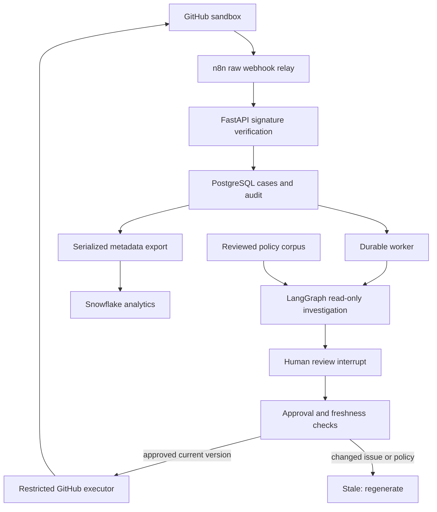

# IssuePilot architecture contract

Status: implementation v0.2.0, accepted project direction on 2026-11-10.
This document is the source of truth. Change it with code when scope changes.
Do not silently remove n8n, LangGraph, RAG, Snowflake, deployment, or evaluation.

## Business problem

An open-source maintainer receives issues with uneven detail. Before fixing a bug,
they must establish intent, identify missing information, consult contributor policy,
and decide whether to request clarification or route the issue. IssuePilot prepares
that decision and presents supporting evidence. A named human controls every write.

The initial user is one maintainer of one explicitly configured GitHub sandbox
repository. Inputs are issue events and a maintainer-controlled Markdown policy
corpus. Outputs are a reviewed comment, additive labels, and optional allowlisted
assignees. It does not fix code, execute attachments, close issues, or make promises.

## Technology ownership

| Technology | Concrete responsibility | Acceptance evidence |
|---|---|---|
| n8n + webhook | Receive GitHub deliveries, preserve exact raw bytes, forward to the trusted verification boundary. The backend validates HMAC before parsing and persists the delivery ID. | Replay the same signed delivery twice through n8n; one case and one accepted delivery. |
| FastAPI + PostgreSQL | Authoritative cases, proposal versions, reviewer identity, decisions, action ledger, immutable analytic events. | No unauthenticated approval, no write without recorded approval, retained audit history. |
| LangGraph + tool calling | Bounded read-only investigation, structured draft, durable human interrupt, resume the correct thread. | Tool trace, persisted checkpoint, restart and resume, stale-source protection. |
| RAG | BM25 retrieval over reviewed local policy chunks. LLM generation cites retrieved IDs and exact quotations. | Evidence visible in review UI; missing/invalid citations rejected; insufficient policy permits abstention. |
| Snowflake | Asynchronous, metadata-only mirror of triage events and operational SQL. | Idempotent sync, full content readback, edit/rejection rates and latency by engine/policy. |
| Docker + CI/CD | Reproducible local services, test jobs, release image, explicit digest-based host deployment. | CI reports, release-to-commit label, health endpoint and sandbox acceptance run. |

**Intake clarification:** n8n is an untrusted transport, not the security authority.
Signature validation occurs at FastAPI immediately after transport; no issue JSON is
interpreted or case created before verification. This avoids duplicating secrets and
cryptographic code in a low-code workflow. The n8n flow does not call an LLM or act
on issue contents before this verification. Do not replace raw bytes with reserialized
JSON: it changes the signature input.

## Flow and trust boundaries

## Agent design

- `read_issue`: read the immutable snapshot being proposed for approval.
- `search_policy(query)`: return at most four chunks from the trusted local corpus.
- `recent_cases`: up to ten locally ingested cases; related context, not authoritative duplicates.
- At most four tool rounds and four calls per round. The model has no write tool,
  shell, arbitrary HTTP tool, credentials, or ability to change repository scope.
- The Ollama model is configurable. `qwen2.5:7b` is a starting configuration, not a
  benchmark winner. `rules` is a deterministic baseline and is clearly labeled in UI.
- BM25 is a deliberate small-corpus retrieval choice. This is lexical RAG, not
  vector search. Add embeddings only if measured retrieval failures justify them.
- Output validation proves schema/allowlists/citation provenance. It does **not**
  prove semantic correctness. Maintainer review and labeled evaluations remain necessary.

## Persistence and state

`deliveries.id` and `(cases.repo, cases.number)` are unique. Separate deliveries for
an edited issue retain one case but create a new proposal version. Webhook content
is a notification; the worker fetches the current source rather than trusting event
arrival order. A source edit during drafting invalidates that draft by version check.

Normal state progression: QUEUED -> PROCESSING -> REVIEW -> APPROVED -> EXECUTING
-> COMPLETED. Rejection resumes the graph into DECLINED. Source or policy changes
lead to STALE. Read/model failures lead to FAILED. Ambiguous external writes lead
to UNCERTAIN and require read-only reconciliation or operator investigation.

Every proposal has an issue fingerprint, policy hash, checkpoint thread ID,
structured value, retrieved evidence and tool trace. Approval includes the exact
proposal/version and authenticated reviewer. The worker checks live issue and policy
again immediately before preparing external actions.

A single PostgreSQL advisory-locked worker prevents competing execution. A local
SQLite path is provided only for a single-worker demo and unit tests. PostgreSQL is
the deployment database and checkpoint store. The v0.1 schema is created on first
boot; future schema changes require explicit migrations, not editing existing tables
implicitly at application startup.

## External side effects

Intent is committed before POSTing to GitHub. Actions have a unique
`(case_id, version, kind)` key. Comments include an action marker. A timeout or crash
after intent is recorded cannot trigger an automatic resend. Reconciliation checks
existing comments/labels/assignees; unresolved partial execution stays UNCERTAIN.

There is no distributed transaction between PostgreSQL and GitHub and no claim of
unconditional exactly-once delivery. A maintainer can edit GitHub after the last
freshness check and before the write; the small remaining race must be acknowledged.
The system guarantees no blind replay of ambiguous writes, not atomic cross-system
transactions. Partial writes are visible in the action ledger.

## Security and data handling

- Live mode requires PostgreSQL, a long webhook secret, configured reviewer tokens,
  a GitHub credential, and a separate write-enable flag.
- Use a fine-grained GitHub token restricted to one sandbox, Issues read/write and
  Metadata read. No Contents write or organization privileges. Rotate it on expiry.
- Reviewer tokens are distinct, server-mapped to identities, sent as bearer headers,
  and never stored in browser localStorage or displayed in audit output.
- Tokens are a small private-demo authentication model, not enterprise SSO. Restrict
  public demos to named reviewers; do not publish a shared write token.
- Issue text is untrusted data. Do not execute its commands or follow its URLs.
- Render issue and model text using DOM `textContent`, not HTML injection.
- Deploy behind HTTPS. Limit request bodies. Keep n8n editor and database private.
- Snowflake receives operational metadata only, not source bodies/comments/tokens.
- Back up PostgreSQL and n8n volumes. Set retention before importing real private data.

## Scope boundaries

Included: classification, missing-information proposals, evidence, approval/edit/reject,
additive labels, optional configured assignees, durable work, audit, evaluation,
containerization, release/deployment recipes and Snowflake event analytics.

Not included: training a model, autonomous remediation, team ownership inference,
calendar/email automation, multi-tenant SSO, enterprise HA, proven time savings.
Team reassignment history is not yet measured; do not claim routing-accuracy gains
from the existing decision metrics. A future `assigned`/`unassigned` event collector
can extend analytics if a real team uses the sandbox.

## Definition of done

Code completion and deployed verification are separate gates. The release can be
called fully accepted only after all entries in README's delivery status have evidence:
local/integration tests, n8n signed replay, actual model evaluation, live sandbox
approval/write, Snowflake readback, CI release and HTTPS deployment. Never replace
missing evidence with a green badge or an invented accuracy number.

## Primary references

- [GitHub webhook validation](https://docs.github.com/en/webhooks/using-webhooks/validating-webhook-deliveries)
- [n8n Webhook node](https://docs.n8n.io/integrations/builtin/core-nodes/n8n-nodes-base.webhook/)
- [n8n raw binary buffer](https://docs.n8n.io/code/cookbook/code-node/get-binary-data-buffer/)
- [LangGraph interrupts](https://docs.langchain.com/oss/python/langgraph/interrupts)
- [LangGraph Postgres checkpoints](https://github.com/langchain-ai/langgraph/tree/main/libs/checkpoint-postgres)
- [Snowflake Python connector](https://docs.snowflake.com/en/developer-guide/python-connector/python-connector-connect)

## Repository label governance and reviewer console

Live proposals use a fresh paginated GitHub label catalog, including descriptions.
`policies/label_rules.json` grants a subset of that vocabulary to the agent. An
optional `IP_ALLOWED_LABELS` setting only narrows the subset. Demo uses an explicitly
identified fixture; a failed GitHub read never silently falls back to that fixture.
The model receives label descriptions and permission flags alongside the issue.
Proposal validation rejects missing or disallowed labels. Catalog and permission
hashes accompany the proposal and are rechecked on approval and before execution;
a mismatch requires a fresh review. The adapter rechecks labels immediately before
its additive labels write. There is no automatic label-creation tool.

`question` describes a usage/support question, not every incomplete bug report.
`duplicate`, `good first issue`, `help wanted`, `invalid`, and `wontfix` remain
maintainer-only under the default policy. Accessibility may accompany bug when
supported by the source. The rules baseline remains intentionally limited.

The console separates Overview, Inbox, Review, Activity and Repository. It displays
recorded engine evidence; a configured model name is not evidence of an LLM call.
Review approval is bound to the displayed case/version. Theme preference can persist;
bearer tokens cannot. Case reads, recovery and decisions are scoped to the configured
repository. The console does not claim that n8n, Snowflake or deployment succeeded
merely because a local case completed.
