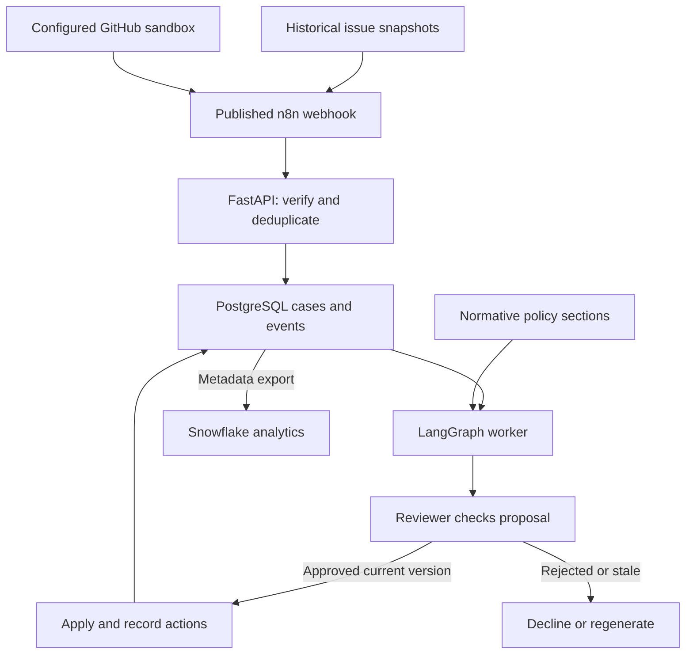

# Architecture

An issue, a model proposal, a reviewer decision and an external action are different records. The intake path accepts signed issue events. A worker proposes the next step. The reviewer controls what is applied.

**Intake.** A snapshot sender verifies the source and projects only the issue fields needed by the app. Stable delivery identities include source revision, repository identity and original issue number. GitHub sends its own delivery ID. The Webhook node receives raw bytes, the Code node preserves them and their signature, and the HTTP node forwards the envelope. FastAPI verifies HMAC against the exact bytes before interpreting the payload. The dataset sender also validates the configured workflow, signed connectivity receipt, distinct case IDs and database readback. A retry must not create a second case.

**Source boundary.** Snapshot mode never writes to GitHub and never passes reference labels or prior assistant messages to the worker. The repository identity used to deduplicate deliveries is distinct from the public source link. Live mode reads the configured GitHub sandbox and applies approved changes only when explicitly enabled.

| Decision stage | Input | Output and owner |
|---|---|---|
| Category | Title and description | Direct Qwen classification: bug, feature request or abstention. No policy context or gold label enters this prompt. |
| Policy retrieval | Case question and admissible issue facts | Topic-weighted BM25 ranks policy sections. The selected arm takes up to four qualifying sections and adds required dependencies. |
| Recommendation | Retrieved evidence and facts | A structured answer checked against the decision schema and cited IDs. Insufficient evidence can lead to abstention. Raw model output cannot execute a write. |
| Review | Source, proposal version, supporting policy and allowed labels | LangGraph checkpoints the case while a named reviewer approves, edits or rejects it. |
| Execution | Current fingerprint, exact decision and action ledger | The worker checks freshness and permissions. In snapshot mode the effects stay local; live mode can add labels/assignees or a comment. Uncertain results require reconciliation. |
| Analytics | Persisted operational events | A separately invoked sync verifies metadata readback in Snowflake. No issue body, comment text or token is exported. |

Clarification can leave a case waiting for a reporter; a qualifying reply can start a fresh review version. The public snapshot dataset contains opening reports, not future conversation history. The offline policy benchmark can ask about closure rules; the application executor does not close source issues. The [AI benchmark](../../ai-bench/BENCHMARK.md) and a [case audit](runbook.md) provide different kinds of evidence.
