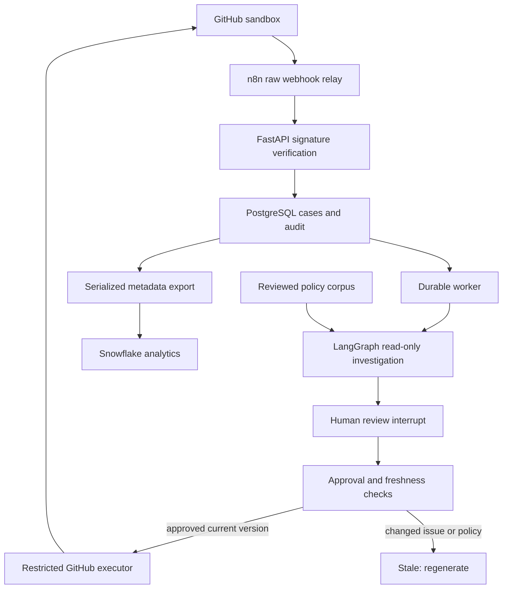
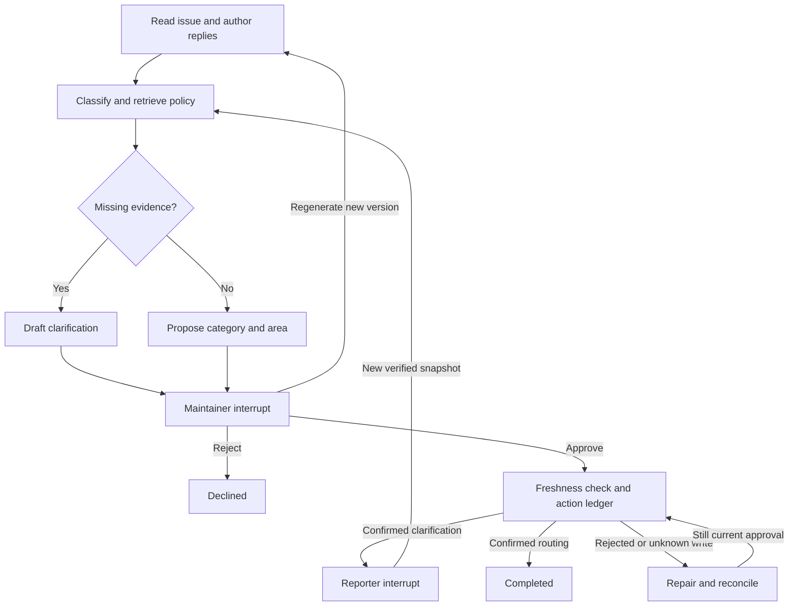

# IssuePilot architecture contract

Status: v0.5.3 (Git checkout and dataset replay). The v0.5.0 AI profile is unchanged.
This document is the source of truth. Change it with code when scope changes.
Do not silently remove n8n, LangGraph, RAG, Snowflake, deployment, or evaluation.

## Business problem

The portfolio replay uses the same verified intake, PostgreSQL case ledger, worker, graph and
reviewer as the operational workflow. Its adapter serves the pinned VS Code issue snapshots
and records approved actions locally. Source labels and historical assistant messages are not
available to inference. The replay has separate credentials, ports and Docker volumes; its
Snowflake cohort is selected by a persisted run ID. See [the demo](portfolio-demo.md).

An open-source maintainer receives issues with uneven detail. Before fixing a bug,
they must establish intent, identify missing information, consult contributor policy,
and decide whether to request clarification or route the issue. IssuePilot prepares
that decision and presents supporting evidence. A named human controls every write.

The initial user is one maintainer of one explicitly configured GitHub sandbox
repository. Inputs are issue events and a maintainer-controlled Markdown policy
corpus. Outputs are a reviewed comment, additive labels, and optional allowlisted
assignees. It does not fix code, execute attachments, close issues, or make promises.

## Technology ownership

| Technology | Concrete responsibility | Acceptance evidence |
|---|---|---|
| n8n + webhook | Receive GitHub deliveries, preserve exact raw bytes, forward to the trusted verification boundary. The backend validates HMAC before parsing and persists the delivery ID. | Replay the same signed delivery twice through n8n; one case and one accepted delivery. |
| FastAPI + PostgreSQL | Authoritative cases, proposal versions, reviewer identity, decisions, action ledger, immutable analytic events. | No unauthenticated approval, no write without recorded approval, retained audit history. |
| LangGraph | Fixed read-only classification and policy tools, structured draft, durable human interrupt, resume the correct thread. | Tool trace, persisted checkpoint, restart and resume, stale-source protection. |
| RAG | Topic-weighted BM25 over normative section IDs, with dependency expansion. Qwen cites retrieved IDs; the adapter displays exact excerpts. | Evidence visible in review UI; missing/invalid citations rejected; insufficient policy permits abstention. |
| Snowflake | Asynchronous, metadata-only mirror of triage events and operational SQL. | Idempotent sync, full content readback, edit/rejection rates and latency by engine/policy. |
| Docker + CI/CD | Reproducible local services, test jobs, release image, explicit digest-based host deployment. | CI reports, release-to-commit label, health endpoint and sandbox acceptance run. |

**Intake clarification:** n8n is an untrusted transport, not the security authority.
Signature validation occurs at FastAPI immediately after transport; no issue JSON is
interpreted or case created before verification. This avoids duplicating secrets and
cryptographic code in a low-code workflow. The n8n flow does not call an LLM or act
on issue contents before this verification. Do not replace raw bytes with reserialized
JSON: it changes the signature input.

## Flow and trust boundaries

## Agent design

The LangGraph draft node calls two fixed read-only stages. The model cannot pick
alternate tools, read URLs, access credentials or call GitHub mutations.

| Stage | Input | Output and boundary |
|---|---|---|
| Classify | Canonical issue title and description only; 16,384 context / 128 output tokens | One of bug, feature-request or ABSTAIN. ABSTAIN goes to manual review without RAG. |
| Retrieve | Current intake question, category and verified reporter evidence | Topic patterns and BM25 rank whole IP sections. Keep top 4 with score ≥8; append all mandatory dependencies. No embeddings or vector service. |
| Apply policy | Question and those sections, 8,192 context / 512 output tokens | One structured read-only model call when evidence exists. NO_POLICY on empty context. A deterministically premature explicit deadline can block without inference. |
| Adapt and review | Validated decision, cited claims, current label catalog | ALLOW can propose a permitted category; NEED_FACTS can propose a bounded clarification. BLOCK, NO_POLICY or ambiguous clarification goes to manual review. Gated proposals retain the original decision and citation trace. |
| Execute | Current approved version; fresh source, policy and permissions | Existing comment/label/assignment ledger only. No close or reopen executor. |

Both calls use the same pinned qwen3:8b digest with thinking off, temperature 0
and seed 42. No judge runs online. The application supplies the intake question;
this adapter and real reporter traffic were **not** scored by the offline validation.
The live corpus is `policies/runtime/issuepilot_policy.md`. The legacy `triage.md`
is confined to the explicit rules demo and its historical CLI controls.

## Persistence and state

`deliveries.id` and `(cases.repo, cases.number)` are unique. Separate deliveries for
an edited issue retain one case but create a new proposal version. Webhook content
is a notification; the worker fetches the current source rather than trusting event
arrival order. A source edit during drafting invalidates that draft by version check.

Normal state progression: QUEUED -> PROCESSING -> REVIEW -> APPROVED -> EXECUTING
-> COMPLETED (routing) or WAITING_REPORTER (clarification). Reporter evidence resumes
the same graph through REPLY_QUEUED, creates a fresh review version, and clears the
previous approval. Unchanged/reordered notifications do not consume a clarification round. Rejection resumes the graph into DECLINED. Source or policy changes
lead to STALE. Read/model failures lead to FAILED. Ambiguous external writes lead
to UNCERTAIN. Definitively rejected writes become BLOCKED. Both expose explicit recovery after the cause is repaired.

Every proposal has an issue fingerprint, policy hash, checkpoint thread ID,
structured value, retrieved evidence and tool trace. Approval includes the exact
proposal/version and authenticated reviewer. The worker checks live issue and policy
again immediately before preparing external actions.

A single PostgreSQL advisory-locked worker prevents competing execution. A local
SQLite path is provided only for a single-worker demo and unit tests. PostgreSQL is
the deployment database and checkpoint store. The v0.1 schema is created on first
boot; future schema changes require explicit migrations, not editing existing tables
implicitly at application startup.

## External side effects

Intent is committed before POSTing to GitHub. Actions have a unique
`(case_id, version, kind)` key. Comments include an action marker. A timeout or crash
after intent is recorded cannot trigger an automatic resend. Reconciliation checks
existing comments/labels/assignees; unresolved partial execution stays UNCERTAIN.

There is no distributed transaction between PostgreSQL and GitHub and no claim of
unconditional exactly-once delivery. A maintainer can edit GitHub after the last
freshness check and before the write; the small remaining race must be acknowledged.
The system guarantees no blind replay of ambiguous writes, not atomic cross-system
transactions. Partial writes are visible in the action ledger.

## Security and data handling

- Live mode requires PostgreSQL, a long webhook secret, configured reviewer tokens,
  a GitHub credential, and a separate write-enable flag.
- Use a fine-grained GitHub token restricted to one sandbox, Issues read/write and
  Metadata read. No Contents write or organization privileges. Rotate it on expiry.
- Reviewer tokens are distinct, server-mapped to identities, sent as bearer headers,
  and never stored in browser localStorage or displayed in audit output.
- Tokens are a small private-demo authentication model, not enterprise SSO. Restrict
  public demos to named reviewers; do not publish a shared write token.
- Issue text is untrusted data. Do not execute its commands or follow its URLs.
- Render issue and model text using DOM `textContent`, not HTML injection.
- Deploy behind HTTPS. Limit request bodies. Keep n8n editor and database private.
- Snowflake receives operational metadata only, not source bodies/comments/tokens.
- Back up PostgreSQL and n8n volumes. Set retention before importing real private data.

## Scope boundaries

Included: classification, missing-information proposals, evidence, approval/edit/reject,
additive labels, optional configured assignees, durable work, audit, evaluation,
containerization, release/deployment recipes and Snowflake event analytics.

Not included: training a model, autonomous remediation, team ownership inference,
calendar/email automation, multi-tenant SSO, enterprise HA, proven time savings.
Team reassignment history is not yet measured; do not claim routing-accuracy gains
from the existing decision metrics. A future `assigned`/`unassigned` event collector
can extend analytics if a real team uses the sandbox.

## Definition of done

Code completion and deployed verification are separate gates. The release can be
called fully accepted only after all entries in README's delivery status have evidence:
local/integration tests, n8n signed replay, actual model evaluation, live sandbox
approval/write, Snowflake readback, CI release and HTTPS deployment. Never replace
missing evidence with a green badge or an invented accuracy number.

## Primary references

- [GitHub webhook validation](https://docs.github.com/en/webhooks/using-webhooks/validating-webhook-deliveries)
- [n8n Webhook node](https://docs.n8n.io/integrations/builtin/core-nodes/n8n-nodes-base.webhook/)
- [n8n raw binary buffer](https://docs.n8n.io/code/cookbook/code-node/get-binary-data-buffer/)
- [LangGraph interrupts](https://docs.langchain.com/oss/python/langgraph/interrupts)
- [LangGraph Postgres checkpoints](https://github.com/langchain-ai/langgraph/tree/main/libs/checkpoint-postgres)
- [Snowflake Python connector](https://docs.snowflake.com/en/developer-guide/python-connector/python-connector-connect)

## Repository label governance and reviewer console

The normative policy defines the vocabulary: IP-LABEL-001 names five primary categories and IP-LABEL-002 defines eleven workflow/resolution labels and their conditions. The intake layer may propose only the supported categories authorized in label_rules.json (currently bug and feature-request). In live mode GitHub reports which exact names are provisioned; unrelated GitHub defaults do not become suggestions, and missing names are not created or silently remapped. A failed GitHub read does not fall back to the demo catalog. The sandbox has the complete local policy vocabulary. The original issue can display its historical source labels; these do not become classifier input or write permissions. Workflow labels are not unrestricted intake suggestions.

The policy/catalog snapshot is rechecked at approval and before execution. Existing historical proposals retain their original evidence. New proposals store complete cited sections. The viewer can expand an older excerpt only from a matching source document saved with that proposal; otherwise it displays the excerpt as recorded. No UI reads current policy to fill a hole in an older decision. Raw source text remains independently inspectable.

The console separates Overview, Inbox, Review and Repository. History is a per-case dialog opened directly from the inbox or execution trace. It displays
recorded engine evidence; a configured model name is not evidence of an LLM call.
Review approval is bound to the displayed case/version. Theme preference can persist;
reviewer tokens persist only in sessionStorage for the current tab session. Case reads, recovery and decisions are scoped to the configured
repository. The console does not claim that n8n, Snowflake or deployment succeeded
merely because a local case completed.

## Recovery contract (0.3.0)

Recovery is a separate authenticated operation bound to case ID and version. It never
changes repository scope or bypasses approval. Existing databases need no migration.

- Read/model failures without external actions: repair the cause, generate a fresh
  proposal and approve it. Durable worker restart recovers interrupted drafting.
- Rejected external actions (including HTTP 403): retain the decision and ledger;
  repair access, then request recovery. Completed actions are preserved.
- Unknown results (timeout, worker crash, server error or legacy UNKNOWN rows): read
  GitHub comments by action marker and inspect labels/assignees. Observed effects
  are marked DONE; this proves current state, not who performed a label change.
- If a remaining UNKNOWN/SENDING action cannot be confirmed, require explicit
  acknowledgement before reattempting. Absence during readback cannot rule out a
  delayed request completing later. Exactly-once comment delivery is not promised.
- Resume checks approved version, repository, live-write flag, current source,
  catalog and policy. The worker rechecks before execution. It preserves action IDs
  and markers, skips DONE actions, and retries only remaining PENDING actions.
- Source/policy changes require cancelling the remainder and generating a fresh
  proposal. DONE actions are not undone. Abandoned unknown actions remain in history;
  a new proposal can repeat an earlier comment, so the reviewer must inspect it.
- Webhooks and demo edits cannot overwrite a failed version with unresolved actions.
- Database or transport outages require restoring that service first. Failed intake
  can be redelivered; this is not an automatic repair of external infrastructure.

Reviewer sessions use sessionStorage, not localStorage. Refresh retains the session;
Disconnect clears it and the visible workspace. HTTP 401 also clears it. A transient
network outage retains the session for reconnection. A normal closed-tab session ends,
but browser restore/duplicate-tab features may preserve sessionStorage: use Disconnect
for explicit sign-out. This clears the browser credential, not the server token itself.
The UI shows the approved payload after review and keeps the original draft separately.

## VS Code multi-turn graph (v0.4)

Three clarification rounds by default; exhausted rounds produce a non-executable
abstention for maintainer investigation. Human regeneration creates a new graph thread
for the same case and carries its round count forward. Reporter replies resume the
existing thread. Only author comments are reporter evidence; maintainer approval is
always a separate authenticated API action. Own marked bot comments are excluded.
Subscribe GitHub webhooks to **Issues and Issue comments**. Manual Check reporter
replies fetches canonical GitHub state if a delivery was missed.

The `execution_wait` interrupt receives a receipt only after the ledger confirms
execution. HTTP 403 cannot advance to reporter waiting. Post-write worker restart
finishes that handoff from the persisted approval/ledger. Legacy completed v0.3 cases
remain completed; start a new proposal to use the new multi-turn behavior. Policy
hash changes make old unexecuted proposals stale; completed actions remain preserved.

Benchmarks are offline. There is no evaluation tab, HTTP job runner or access to
a judge in the operational application. Historical rules CLI controls remain
separate. Snowflake mirrors operational events independently.

A read/model error during reporter processing becomes REPLY_FAILED, not an uncertain
external write. Authenticated refresh resumes the stored draft checkpoint after repair;
regression tests verify that no already-sent clarification is republished.
