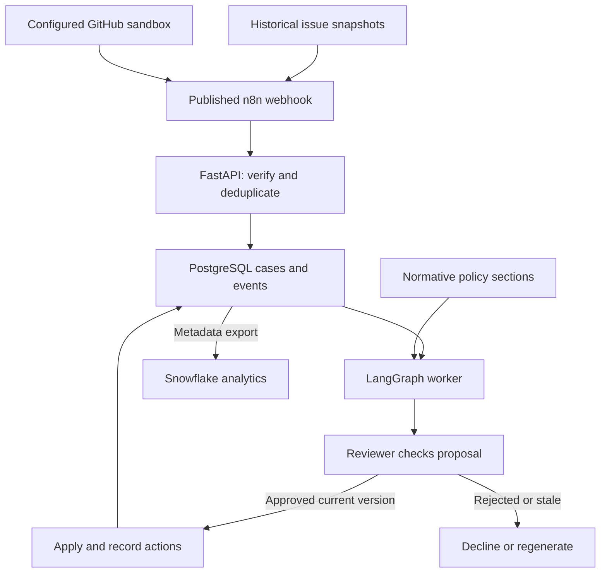
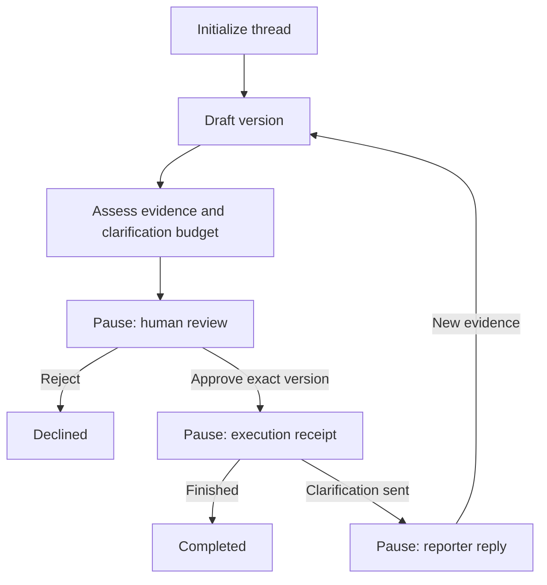
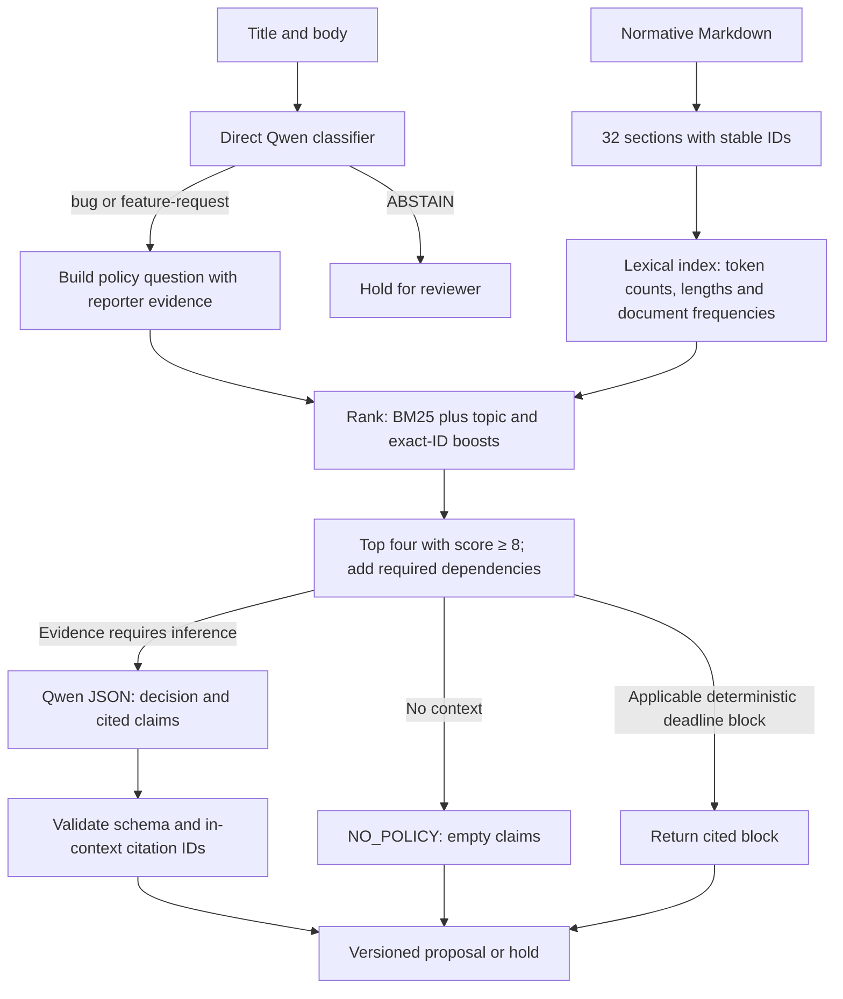
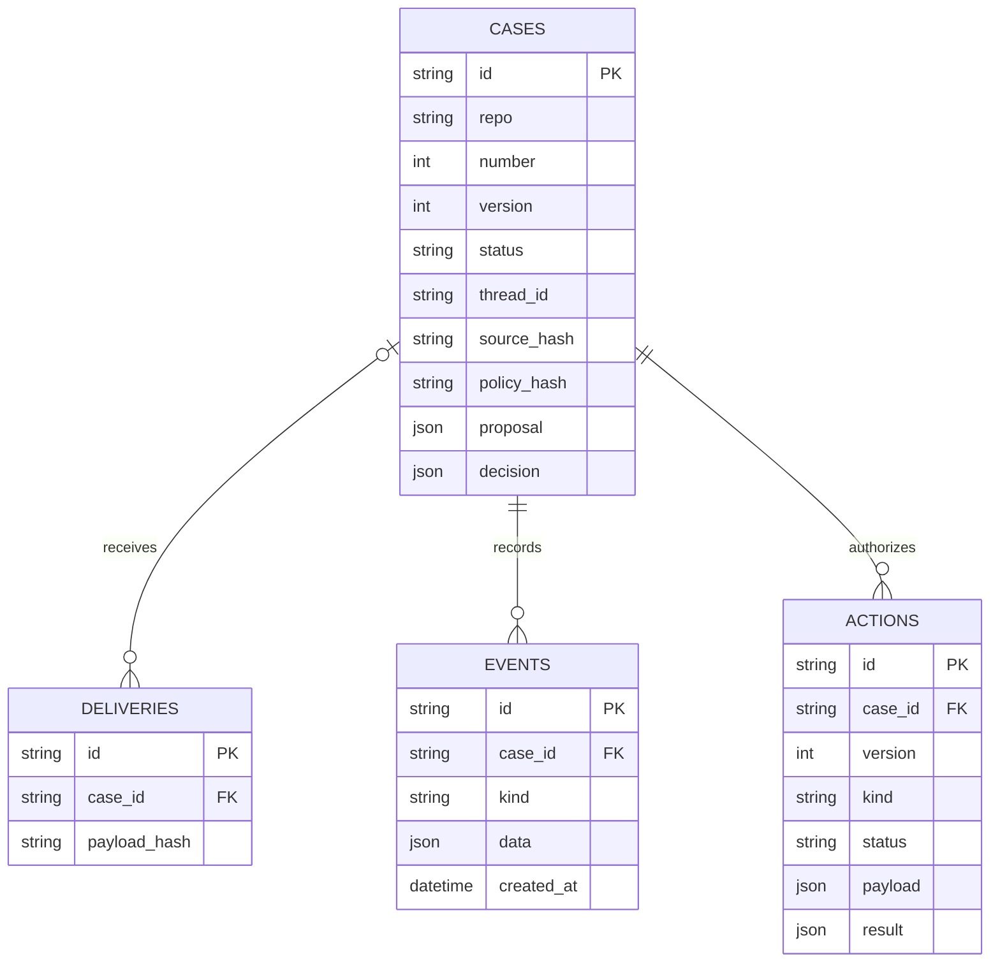

# Architecture

An issue, a model proposal, a reviewer decision and an external action are different records. The intake path accepts signed issue events. A worker proposes the next step. The reviewer controls what is applied.

**Intake.** A snapshot sender verifies the source and projects only the issue fields needed by the app. Stable delivery identities include source revision, repository identity and original issue number. GitHub sends its own delivery ID. The Webhook node receives raw bytes, the Code node preserves them and their signature, and the HTTP node forwards the envelope. FastAPI verifies HMAC against the exact bytes before interpreting the payload. The dataset sender also validates the configured workflow, signed connectivity receipt, distinct case IDs and database readback. A retry must not create a second case.

**Source boundary.** Snapshot mode never writes to GitHub and never passes reference labels or prior assistant messages to the worker. The repository identity used to deduplicate deliveries is distinct from the public source link. Live mode reads the configured GitHub sandbox and applies approved changes only when explicitly enabled.

| Decision stage | Input | Output and owner |
|---|---|---|
| Category | Title and description | Direct Qwen classification: bug, feature request or abstention. No policy context or gold label enters this prompt. |
| Policy retrieval | Case question and admissible issue facts | Topic-weighted BM25 ranks policy sections. The selected arm takes up to four qualifying sections and adds required dependencies. |
| Recommendation | Retrieved evidence and facts | A structured answer checked against the decision schema and cited IDs. Insufficient evidence can lead to abstention. Raw model output cannot execute a write. |
| Review | Source, proposal version, supporting policy and allowed labels | LangGraph checkpoints the case while a named reviewer approves, edits or rejects it. |
| Execution | Current fingerprint, exact decision and action ledger | The worker checks freshness and permissions. In snapshot mode the effects stay local; live mode can add labels/assignees or a comment. Uncertain results require reconciliation. |
| Analytics | Persisted operational events | A separately invoked sync verifies metadata readback in Snowflake. No issue body, comment text or token is exported. |

Clarification can leave a case waiting for a reporter; a qualifying reply can start a fresh review version. The public snapshot dataset contains opening reports, not future conversation history. The offline policy benchmark can ask about closure rules; the application executor does not close source issues. The [AI benchmark](../../ai-bench/BENCHMARK.md) and a [case audit](runbook.md) provide different kinds of evidence.

## What LangGraph persists

The graph handles pauses that outlive a worker process. The worker coordinates those checkpoints with the case and action tables; the graph does not call GitHub when a maintainer clicks a button.

A changed source or policy invalidates stale approval. If a network call may have succeeded, the action ledger records uncertainty. Recovery inspects the external result before permitting another write. See [graph nodes](../src/issuepilot/agent.py), [worker transitions](../src/issuepilot/worker.py) and [action handling](../src/issuepilot/service.py).

## Inside the selected RAG profile

The search input is a question about this report's readiness for intake, together with its facts. The retriever first ranks up to eight sections, chooses among the first four, then adds dependencies; the final context can contain more than four sections. Ranked retrieval metrics and **complete context after expansion** measure different steps. A schema-valid citation proves the ID exists in the supplied text; it does not prove the generated sentence follows from it. The deadline branch is relevant to policy scenarios, not a scheduled GitHub closer. See [index](../src/issuepilot/ai/index.py), [decision protocol](../src/issuepilot/ai/generation.py) and [proposal mapping](../src/issuepilot/ai/triage.py).

## Data model

The database enforces one case per `(repo, number)` and one action per `(case_id, version, kind)`. A delivery can exist without a linked case. The sandbox adapter also uses `demo_issues(number, data, comments)`; it is not a child table of cases. LangGraph owns separate checkpoint tables; the application references a thread by ID. The separately provisioned Snowflake table holds **EVENT_ID, BODY (VARIANT), HASH**. It is a verified mirror, with no foreign key across databases. [SQLAlchemy schema](../src/issuepilot/db.py) · [export allowlist and readback comparison](../src/issuepilot/analytics.py).

## Tool ownership

| Layer | Tools | What runs here |
|---|---|---|
| Intake and trust | n8n, FastAPI, HMAC | Preserve original bytes, authenticate the delivery, reject repeats or conflicting payloads. |
| State and recovery | PostgreSQL, SQLAlchemy, LangGraph | Keep the authoritative case, durable pauses, versioned approvals and action receipts. |
| Classification | Ollama, Qwen3 8B | Choose bug or feature-request from the title and body; abstain outside the supported decision. |
| Policy retrieval | Python, topic-weighted BM25 | Rank the small versioned corpus locally. No embedding service or vector database is needed in the selected profile. |
| Generation and validation | Ollama, Qwen3 8B, JSON contracts | Draft with permitted evidence. The model has no GitHub write credentials of its own. |
| User review and actions | Browser UI, FastAPI, sandbox/GitHub adapter | Compare the issue, saved policy evidence and proposal; approve, reject or recover a specific version. |
| Offline experiments | ai-bench; Qdrant and encoders for optional dense arms | Compare controlled alternatives using fixed splits. The judge is optional and offline. |
| Analytics and delivery | Snowflake, Docker Compose, GitHub Actions, GHCR | Verify mirrored events, test changes, build tagged images; deployment is a separate opt-in action. |

The [original workflow plan](../issuepilot_workflow_and_evaluation_plan.md) is historical. Use this page for implemented behavior and the [model selection report](ai-selection.md) for measured behavior.
