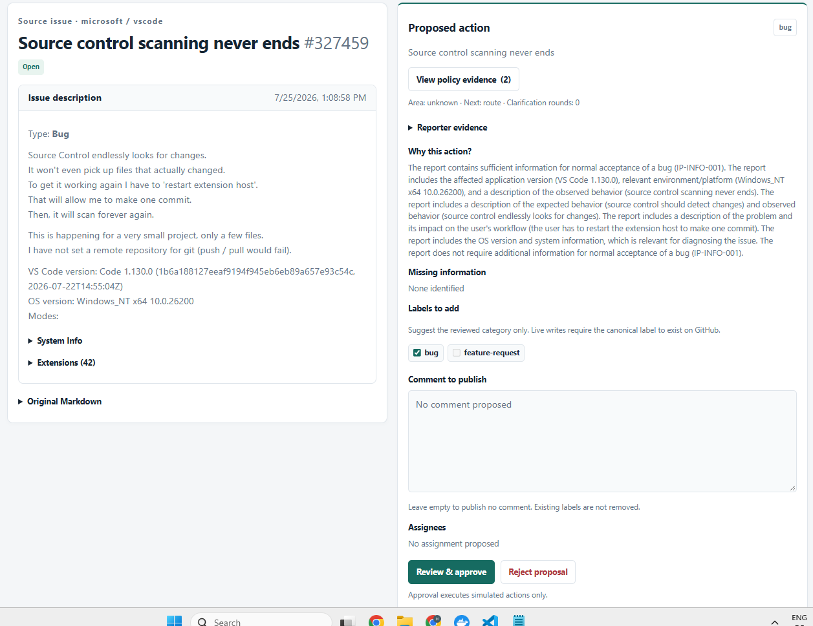
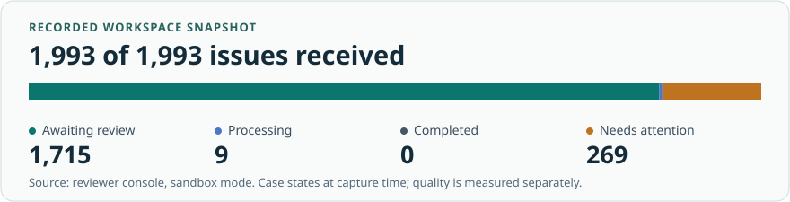

# Walk through one issue, then show the scale

Use the same workspace ID, source issue and proposal version throughout the walkthrough. In the recorded demo the case was [microsoft/vscode#327459, “Source control scanning never ends”](https://github.com/microsoft/vscode/issues/327459). It was a historical snapshot, so approving it would affect only the IssuePilot sandbox.

| Available capture | What it establishes | What it does not establish |
|---|---|---|
| [n8n canvas](images/n8n-intake.png) | Three connected nodes: receive issue event, preserve signed payload, submit issue to triage. | The canvas alone does not prove a successful delivery. |
| [Workspace overview](images/workspace-overview.png) | **1,993 / 1,993 received**. At capture: 1,715 awaiting review, 9 processing, 0 completed, 269 needing attention. | These are state counts at one point in time, not 1,993 correct predictions or completed reviews. |
| [Inbox](images/inbox.png) | Public issue numbers, different states, Review/Inspect and per-case audit entry points. | The number visible in an inbox filter is not dataset accuracy. |
| [Source and proposed action](images/review.png) | The original report alongside a proposed bug label and maintainer controls for #327459. | No review decision is visible in this capture. The reporter's own “Type: Bug” is part of the original text. |
| [Policy evidence dialog](images/policy-evidence.png) | IP-INFO-001, the table of required fields, highlighted bug row and saved version. | A valid reference is not a semantic evaluation of every generated claim. |

These five original captures were taken with v0.6.0. The link on the intake chart opens the corresponding unedited screenshot.

The CI artifact `reviewer-ui-fixtures` also contains Chromium captures of Review, Policy evidence and the case audit dialog. Those use test fixtures to verify rendering, separately from the five operator screenshots above.

An independent intake check on this release used n8n 2.47.3, FastAPI and disposable PostgreSQL 18.7. The full source produced **1,993 cases, 1,993 delivery records and 1,993 distinct n8n execution IDs on RECEIVED events**. Reposting an existing signed delivery returned its original case; `submit --resume` skipped all 1,993 and posted zero. The worker was not run in that check. This verifies transport and idempotence, independently of the earlier operator screenshots and model evaluation.

**The next two screenshots add the most evidence:**

1. **One case to completion.** In the snapshot workspace, open #327459 (or use one other case consistently). Review its exact version, approve if appropriate and reopen **Inbox → Open audit history** for that case. Capture the proposal version, approval and the terminal action/receipt. If the action failed or needs reconciliation, show that actual state; do not caption it as completed.
2. **Warehouse readback.** With source activity stable, check and sync using the [Snowflake guide](snowflake.md). Capture `VERIFIED` and the result of the first SELECT in [intake_metrics.sql](../warehouse/intake_metrics.sql): same workspace, issues received, proposals, reviews, distinct event IDs and duplicate IDs. A second verified sync with zero inserts is evidence of idempotence for that unchanged batch.

For an engineering audience, also open **n8n → Executions**, select a successful execution and match its ID to the case's RECEIVED event. Capture the [CI run](https://github.com/BlazingVermilion/issuepilot-sandbox/actions/workflows/ci.yml) for the commit being presented. A green CI job proves its listed checks; a deployed environment or GHCR artifact needs its own run and digest.

For LinkedIn, use **Review → Policy evidence → Audit → Snowflake**. The inbox and overview are useful in the longer GitHub walkthrough. Annotate model quality with the [benchmark report](ai-selection.md), not the queue count. Crop browser/taskbar clutter if desired and keep reviewer tokens, signed webhook bodies, account secrets and keys out of frame.
