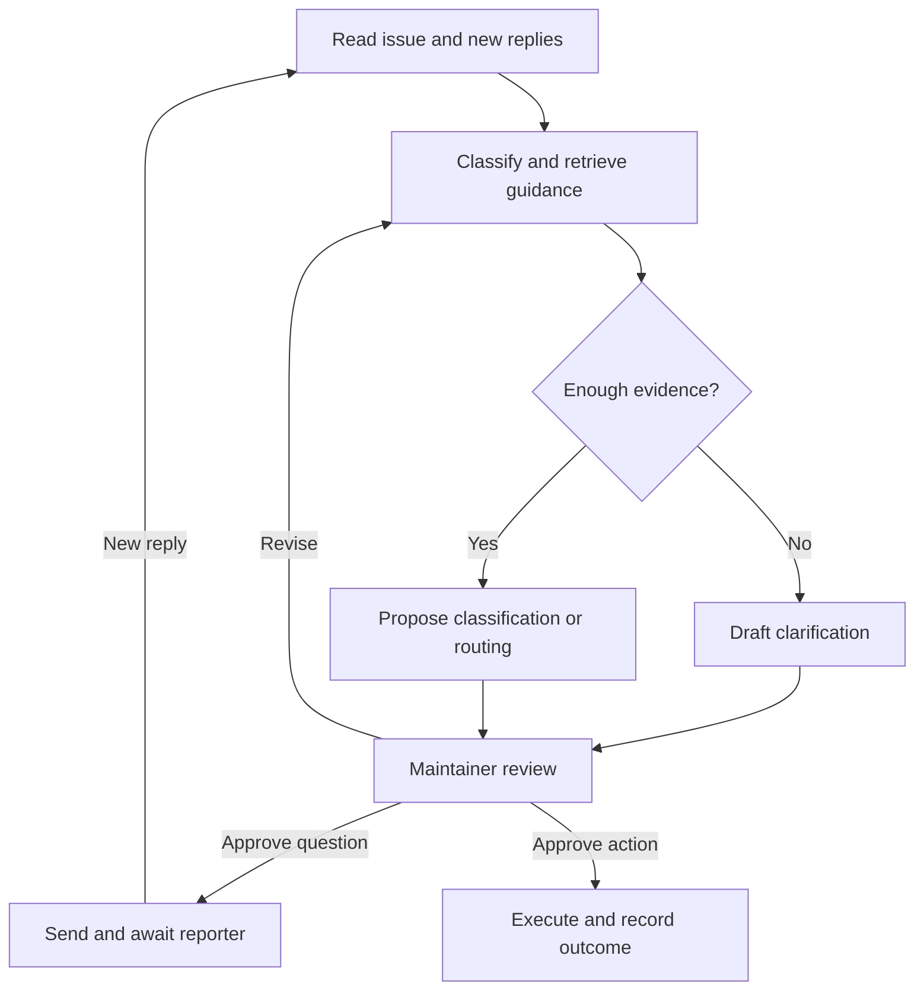

# IssuePilot: workflow and evaluation plan

Historical v0.4 design record. The current application uses the [selected AI profile](docs/ai-selection.md) and has no evaluation tab.

Date: 2026-11-12
Status: v0.4.0 implementation and deterministic benchmark runs completed locally. Qwen, real linked-source coverage and live deployment acceptance remain unmeasured. NLBSE is deferred.
This record preserves the accepted design and identifies measured versus pending evidence below.

## Accepted workflow

Initial scope: incomplete bug reports, extension-related reports and feature-area
classification, adapted from public VS Code guidance. Do not claim Microsoft
endorsement or replication of private internal processes.

Persist case identity, source/policy revisions, retrieved evidence, known facts,
missing information, clarification rounds, reporter/maintainer wait state,
reviewed proposal and action ledger. Reporter replies are evidence, not approval.
Use separate resumptions for reporter input and authenticated maintainer decisions.
Bound clarification rounds; missing evidence or exhausted rounds escalate to a human.
Deterministic code owns permissions, deduplication, freshness and execution. LLMs
interpret text and propose actions. Retain v0.3 recovery and partial-write controls.

Public workflow references:
- https://github.com/microsoft/vscode/wiki/Issue-Tracking
- https://github.com/microsoft/vscode/wiki/Issues-Triaging
- https://github.com/microsoft/vscode/wiki/Community-Issue-Tracking
- https://github.com/microsoft/vscode/wiki/Feature-Areas
- https://github.com/microsoft/vscode/wiki/Automated-Issue-Triaging

## Dataset review

The original selection used publisher documentation. The VS Code dataset has now
been downloaded and audited at the pinned revision recorded below. Other candidates
have not been audited or integrated.

| Candidate | Published scope | Recommended role |
|---|---|---|
| NLBSE 2023 issue-report-classification | Approximately 1.4M reports; bug, feature, question, documentation; single-label English classification | Established auxiliary classification benchmark, not policy retrieval or multi-turn ground truth |
| Tilakoid/vscode-bug-feature-triage | 1,993 VS Code examples; bug vs feature-request; provided temporal-per-class splits | Small initial batch benchmark; third-party, not Microsoft-maintained |
| ish-codes-magic/triage-bench | Publisher reports 5,476 CPython opening snapshots and silver labels | Methodology reference and possible later transfer benchmark; not a VS Code-policy benchmark |
| SWE-bench | Repository issue resolution benchmark | Not the primary benchmark for intake triage |
| GH Archive plus GitHub source history | Public events and issue discussions | Inputs for a curated VS Code replay corpus, not a ready-made annotated benchmark |

Sources:
- https://github.com/nlbse2023/issue-report-classification
- https://huggingface.co/datasets/Tilakoid/vscode-bug-feature-triage
- https://github.com/ish-codes-magic/triage-bench
- https://huggingface.co/datasets/SWE-bench/SWE-bench
- https://www.gharchive.org/

The VS Code binary dataset omits original raw snapshots. Its messages array includes
an assistant target label: inference must use input text only. Current labels and
edited issue bodies may reveal later decisions. A split by creation timestamp does
not itself prove that text is from creation time. It contains no policy relevance
judgments or full reporter conversation. The CPython benchmark documents model-
adjudicated references and an outstanding human check; do not treat it as human gold.
NLBSE's documented schema does not provide the policy relevance annotations needed
for our retrieval evaluation. Publisher availability is not a quality guarantee.

## Evaluation contract: two independently reported layers

All routine scoring is automatic. Human approval remains a product safeguard; the
benchmark supplies scripted reviewer decisions to an offline adapter. Automatic
scoring is not the same as automatically discovering semantic truth. Publish evidence
levels, denominators, exclusions and coverage. Do not combine layers into one score.

### Layer 1: issue-type classification on real VS Code data

Current code: Analyst.llm in src/issuepilot/agent.py uses ChatOllama, tool calls and
structured Proposal output. The category field is an inference from a pretrained
LLM; there is no task-specific training, classifier fitting or anomaly detector.
Analyst.baseline is a separate keyword/regex comparator, not an ML model.

Freeze the existing VS Code dataset revision and splits: 1,593 train, 200 validation,
200 test according to its card, to be verified on download. Use train/validation for
prompt and retrieval development; keep test untouched until the configuration is
locked. Only the input text enters inference. Never pass label, assistant target
messages, final state or later comments. Avoid live issue tools in this benchmark.

Benchmark categories are bug and feature-request. The app now emits feature-request directly; a fixed legacy enhancement adapter
remains at the scoring boundary. Other categories, abstentions, invalid JSON
and exhausted failures are not silently removed. Label-field permissions are a
separate product concern; the binary scorer reads category, not GitHub action labels.

| Metric | Automatic calculation | Interpretation |
|---|---|---|
| Primary macro-F1 | Average F1 over the two target classes; invalid/abstained predictions contribute false negatives for their true class | Agreement with dataset labels, not universal human correctness |
| Accuracy | Correct category / all scheduled test records | Includes failed cases as incorrect |
| Per-class precision, recall, F1 | Fixed confusion matrix including OTHER, ABSTAIN and ERROR output columns | Shows imbalance and error direction |
| Coverage | Valid in-scope predictions / all scheduled records | Prevents high scores from hiding abstentions |
| Selective accuracy | Correct / valid in-scope predictions, undefined when none | Secondary; always paired with coverage |
| Contract/failure rates | Valid Classification outputs in A, full Proposal outputs in B1 / scheduled; timeouts and model errors / scheduled | Operational reliability |
| Latency | End-to-end p50/p95, model-call count, timeout fraction | Report successful and all-attempt durations separately |
| Usage | Measured input/output tokens where backend exposes them | Missing telemetry is unknown, not zero |

References are inherited dataset labels (silver, potentially noisy). The small binary
set does not measure feature-area routing, support questions, multi-label quality,
missing-information detection or an unbiased real-world label distribution.

Comparisons: keyword rules; same LLM without policy; same LLM with full frozen policy;
same LLM with BM25; optionally hybrid retrieval. Hold model revision, input budget,
decoding and dataset fixed. Full-policy is eligible only if it fits the declared
context budget; disclose truncation. The no-policy arm still receives the task and
output schema. Do not assume retrieval must improve binary classification.

### Layer 2A: RAG retrieval and policy application

The binary VS Code dataset has no relevant-policy-section answer key. Do not publish
real-issue policy Recall@k from its labels alone. Use three distinct evidence tracks:

1. Controlled policy probes: construct queries with known source-section IDs from a
   frozen policy snapshot. Generator lineage supplies the reference automatically.
   They are synthetic probes, not real-issue relevance gold. Source-conditioned
   paraphrases may be used but can be ambiguous; report them separately as silver.
   Hide section titles/IDs and exact quotations from query input to limit trivial lookup.
2. Traceable real-issue subset: where a historical maintainer explicitly links a
   specific policy section, extract that URL/anchor as a silver reference. Exclude
   generic links without identifiable evidence. Only the pre-link issue prefix enters
   inference. Missing links are unjudged, not negative. Report subset coverage.
3. Controlled policy application: use declared templates with exact facts, explicitly
   empty required fields and staged replies. Expected missing field IDs and next steps
   come from the scenario specification, independently of the production validator.
   These test adherence on controlled examples; they do not establish comprehension
   of arbitrary natural-language reports. No new manual qualitative scoring is required.

| Metric | Reference / denominator | Claim allowed |
|---|---|---|
| Section Recall@1/4/8 | For controlled probes with enumerated relevant sections: retrieved relevant / all relevant, macro-average over queries | Retrieval of known probe references |
| Linked-source Hit@k and MRR | For real issues with explicit section links: any recorded target in top k; reciprocal first-target rank | Recovery of recorded historical references, not exhaustive relevance recall |
| Evidence provenance validity | Citations whose ID/hash exists in the frozen corpus and quote matches / all emitted citations | Provenance only, not semantic support |
| Citation coverage | Proposals with actionable recommendations and at least one valid citation / all actionable proposals | Evidence attachment, not correctness |
| Missing-field micro-F1 and exact-set accuracy | Predicted field IDs vs known scenario missing fields | Controlled policy compliance |
| Already-known-field request rate | Structured clarification fields intersect known fields / all requested fields | Redundant structured requests in scenarios |
| No-evidence violation rate | Actionable outputs on deliberately unsupported scenarios / all such scenarios | Controlled abstention behavior |

Use stable section-level IDs, deduplicate chunks within a section before scoring, and
freeze reference availability. If k exceeds corpus size disclose effective k. A no-
relevant-source case has no recall denominator; score abstention separately. A failed
query counts as zero retrieval where relevant evidence exists. For linked-source
subsets include unreachable-target counts; do not silently exclude them to raise scores.
Known references are not necessarily all relevant references.

Free-text semantic faithfulness, helpfulness and adequacy remain UNMEASURED by these
automatic checks. Optional independent LLM-judge estimates may be logged separately
with judge version/prompt, but never presented as ground-truth accuracy. No LLM judge
is needed for the primary contract. A policy hash and exact citation do not prove that
the cited policy supports the recommendation. Mechanical checks cannot detect every
contradiction or unsupported claim in a free-text comment.

### Layer 2B: LangGraph workflow reliability

Use deterministic scenario fixtures plus a scripted offline reporter/reviewer, not a
human scorer. Cover complete/incomplete reports, partial replies, reviewer rejection
and edits, source/policy changes, restart while waiting, duplicate and reordered events,
read failure, rejected writes, ambiguous writes and the round-budget limit.

| Metric | Automatic assertion |
|---|---|
| Episode success | Expected terminal state plus required action/field invariants achieved within budget / all episodes |
| Transition conformance | Episodes with no forbidden transition / all episodes; optional valid transitions / all observed transitions |
| Resume correctness | Resumed episodes preserve case identity, version, known facts, wait target and ledger / restart scenarios |
| Authorization violations | Number of external write attempts without a matching current approval; target zero |
| Confirmed-action duplicates | Additional attempts for an already DONE action; target zero |
| Event idempotency | Duplicate-delivery scenarios with unchanged logical effects / duplicate scenarios |
| Recovery success | Repairable fault scenarios that reach expected outcome after scripted repair/recovery / repairable fault scenarios |
| Bounded termination | Episodes that finish or escalate within configured rounds/calls / all scenarios |

Unknown-response replay is measured separately: assert no blind resend and explicit
acknowledgement when required. Do not claim exactly-once delivery from finite tests.
Test at two levels: deterministic model/tool stubs to isolate orchestration defects,
and the real local LLM to expose end-to-end errors. Report them separately. Scripted
review approval is a test input, never a production authentication bypass. Run actual
compiled LangGraph and persistent checkpointer in recovery tests, not only mocks.

To demonstrate framework value, compare the same approved workflow with and without
persistent checkpoints under the same restart scenarios. This tests the benefit of
persistence, not superiority over every custom state-machine implementation.

### Run protocol and reporting

- Pin model tag plus digest when available, dataset hash, policy hash, code revision,
  prompts, decoding, input limits, tool budgets and retriever settings.
- Split by issue, keeping all turns and near-duplicates together. Validate cross-split
  leakage. Do not expose future responses, labels or solution references as inputs.
- Freeze test sets; choose configuration on validation only. Run at least three model
  repeats if affordable and report variation, not only the best run.
- Report counts, paired differences and issue-level bootstrap intervals. Two hundred
  test cases permit only limited precision; do not claim tiny gains are decisive.
- Explicitly separate real labelled data, linked-source silver data, controlled probes,
  and injected-failure scenarios. No blended headline accuracy.
- Report exclusions and data eligibility. Missing/deleted history is not an empty issue.
- Future NLBSE evaluation is a separate benchmark, not part of the current acceptance.

## Proposed acceptance gates (not measured results)

Security gates: zero unauthorized writes and zero resends of confirmed DONE actions
in the deterministic suite; all defined transition/restart scenarios pass. A passing
suite is bounded evidence, not proof over every possible failure.
Quality gates: compare paired macro-F1 and retrieval results against the chosen baseline
at stated cost/latency budgets. Do not predeclare an arbitrary 95% real-world accuracy
target or assume RAG/hybrid must win. Keep full-policy and BM25 if they outperform a
more complex method. Expose inconclusive results and small sample uncertainty.

## Replay is not a counterfactual user simulator

A historical reporter answered a historical maintainer. If our agent asks a different
question, that recorded reply is not proof the reporter would respond the same way.
Use historical replay to evaluate next-step decisions on fixed observed prefixes.
Evaluate branching mechanics with clearly labeled scripted scenarios, and use a small
live human session for actual interactive behavior. Never report offline replay as
measured staff time saved or guaranteed real-world resolution.

## Data contracts and implementation sequence

Keep inputs and hidden references separate:
- inputs: case_id, repo, issue_number, snapshot_at, title, body, visible replies;
- references: expected fields, acceptable policy section IDs, expected next step;
- provenance: source URLs, acquisition time, dataset/policy revisions, hashes;
- results: prediction, evidence, node transitions, errors, latency and usage.

Review rights and attribution for each source; a code license does not automatically
license issue prose. Preserve source links, minimize personal data and publish only
appropriately redistributable fixtures or fetch manifests.

Next implementation: audit a small downloaded sample; build a read-only dataset
adapter and hidden-reference scorer; generate controlled policy probes and extract the eligible linked-source subset; then implement
multi-turn graph nodes. Add a dataset/run selector to UI and export JSON/CSV metrics.
The following implementation map supersedes the earlier implementation sequence.

## v0.4.0 implementation map — 2026-11-12

Terminology in the executable runner: **A** = Layer 1; **B1** = Layer 2A;
**B2** = Layer 2B. No combined headline score is produced.

| Accepted item | Implementation | Evidence / remaining limit |
|---|---|---|
| VS Code public workflow as main RAG source | `policies/triage.md`, `policies/sources.json`, `policy.py` | Local attributed adaptation with stable section IDs; upstream URLs/hash manifest. Raw documents are not silently treated as executable policy. |
| Match selected dataset labels | `label_rules.json`, `labels.py`, agent and benchmark adapter | bug + feature-request; live catalog intersection still required, no automatic label creation. |
| Read issue and author replies | `github.py`, signed issue_comment intake | Paginated canonical source, only author replies; edits/deletions supported, no reporter approval privileges. |
| Multi-turn LangGraph | `agent.py`, `worker.py` | Maintainer, executor and reporter interrupts; fresh version after reply, three-round default, new approval required. |
| Revise / reject / edited approval | Existing review controls plus regeneration from REVIEW | Regeneration uses a fresh graph thread for the same case and preserves its round count; reporter resume keeps its thread. |
| Execution / retry controls | Existing ledger plus execution receipt handoff | Partial actions preserved; 403, unknown timeout and stale-source tests retained. |
| Layer A real-data adapter and scorer | `benchmarks.py`, `scripts/benchmark.py` | Input-only boundary; rules/no-policy/full-policy/BM25 arms; failures kept; model runs pending locally. |
| Data audit | Fixed revision/sha/count/ID/text and near-duplicate candidate checks | All 1,993 rows audited; no exact duplicates or heuristic cross-split near-duplicate candidates detected. Semantic leakage still unproven. |
| Layer B retrieval probes | `fixtures/policy_probes.json` | Seven controlled references; Recall@1/4/8 and MRR measured. Not real-issue gold. |
| Policy application | `fixtures/policy_scenarios.json` | Seven controlled cases; field, next-step, area, redundancy, unsupported-action and citation metrics. |
| Historical linked-source subset | `linked_sources.py`, `links` CLI | Extractor implemented and fixture-tested; **real coverage = 0** pending evidenced historical snapshots. No recall claim on binary dataset labels. |
| Workflow and checkpoint evaluation | `workflow_benchmark.py` | 18 graph/API/ledger scenarios, actual compiled graph and reopened SQLite checkpoints, in-memory restart control. |
| Authorization/duplicate/recovery metrics | Instrumented simulated adapter + pytest | Zero unauthorized / confirmed-duplicate attempts in the executed episodes, not a universal delivery guarantee. |
| Repeat and paired comparison | CLI output directories, `compare` command | Issue-level bootstrap CI and paired deltas implemented. Three Qwen repeats have not run. |
| Usage and provenance | Per-row usage, digest lookup, fixture/code/policy/dataset hashes | Unknown usage/digest is null; Python code hash and full release manifest provide traceability. |
| UI run selection / exports | Evaluation tab + authenticated job endpoints | Fixed choices, one bounded subprocess, JSON/CSV; source/static/API tests, browser acceptance pending. |
| CI integration | Existing CI now runs B1/B2 and uploads reports | Actual hosted CI/container results remain to be collected. |

### Measured results (rules only)

- Dataset revision: `15c7d77e083d0cd30ae84cc5de6add1dce6cf950`.
- A validation: 200 records; macro-F1 **0.4081527**, accuracy **0.34**, coverage
  **0.505**, selective accuracy **0.6732673**, model/runtime failures **0**.
  95% issue-bootstrap macro-F1 interval: approximately **[0.3402, 0.4737]**.
  The high abstention count is retained, not hidden from scores.
- B1 controlled retrieval: Recall@1 **4/7**, Recall@4 **6/7**, Recall@8 **7/7**.
  Seven controlled application cases pass the declared field/next-step contracts.
  These simple fixtures do not establish semantic understanding of real issue prose.
- B2: **18/18** controlled episodes passed. Eight graph traces obeyed their allowed
  transition checks. Ten simulated adapter attempts, zero unauthorized attempts,
  zero repeated confirmed actions. Both in-memory restart controls lost state while
  persistent checkpoint scenarios resumed successfully.
- Automated regression suite: **57 tests passed**. Lint, formatting and JS syntax pass.
- No test-split accuracy, Qwen superiority, human productivity, real historical
  relevance recall, live GitHub/Snowflake or deployment result is claimed.

### Deliberate boundaries and remaining evidence

A uses a dedicated category/abstain schema to isolate classification; B1 exercises
the production Proposal schema and read-only tools. Do not equate these contract rates.
Feature-area routing is local metadata, not a reproduction of Microsoft's private
ownership process. Exact citations are provenance checks, not semantic entailment.

The historical silver subset cannot be manufactured from the binary dataset: it
lacks full conversations and verifiable opening snapshots. The extractor is ready,
but a real run needs a defensible acquisition source. Generic current issue downloads
would silently introduce future context; they are not used as replacement gold.

Run instructions and output contracts live in `docs/runbook.md` and
`docs/evaluation.md`. The delivered ZIP contains source and sanitized deterministic
reports. Raw dataset text, credentials, environments and runtime databases are excluded.
